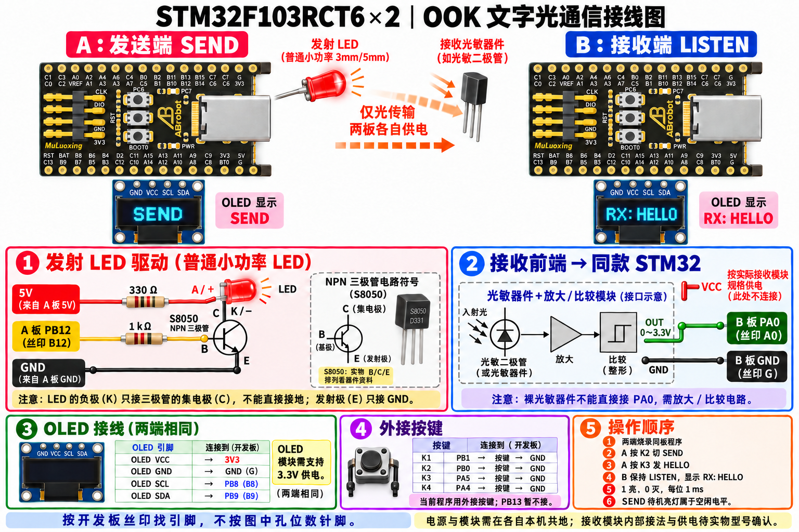

> 历史版本：本图仅适用旧 1000bit/s 文字固件。当前语音与文字固件已改为 PA2 发射、PA3 接收、PA1 音频输入、PA4 音频输出、PC0 为 K4。请按同目录《文字与语音接线说明.md》接线。

# OOK 双板实物接线清单

发送端 A 和接收端 B 均使用用户照片中的 STM32F103RCT6 开发板，烧录当前同一份 OOK 程序。本清单适用于当前 1000 bit/s 文字链路。

请以最终版图片和本清单为准，前面的生成预览图作废。生成图片中的开发板外观用于示意，准确定位请对照保存的用户原图及实物丝印，不要按渲染图数排针孔位。

## 发送端 A：普通小功率 LED 与 S8050

| 从哪里接 | 接到哪里 |
|---|---|
| A 板 5V | 330Ω 电阻的一端 |
| 330Ω 电阻另一端 | LED 阳极 A（+） |
| LED 阴极 K（−） | S8050 集电极 C |
| A 板 PB12（丝印 B12） | 1kΩ 电阻的一端 |
| 1kΩ 电阻另一端 | S8050 基极 B |
| S8050 发射极 E | A 板 GND（丝印 G） |

5V 与 PB12 是独立线路，不能直接相连。LED 阴极仅接 C，不能直接接地。S8050 的实物 B/C/E 排列需按手中器件的数据手册确认；图中的电路符号不代表实物引脚顺序。330Ω 示例用于 5V 供电的普通小功率 LED，大功率灯珠需要按额定电流配置驱动。

## 接收端 B：接收模块输出接 PA0

| 接收前端 | B 板 |
|---|---|
| OUT 数字输出（0～3.3V） | PA0（丝印 A0） |
| GND | GND（丝印 G） |
| VCC | 按实际模块额定供电要求连接，当前图不指定电压 |

光敏器件必须经过放大和比较，得到数字高低电平后再接 PA0。仅有 STM32 板和裸光敏二极管不能按此固件直接完成接收。当前还未提供实际接收前端的型号，因此图中这一部分是接口示意，内部电路和供电待实物确认。

若 LED 亮时接收模块 OUT 为低电平，将 Hardware/OOK.h 中的 OOK_RX_INVERTED 改为 1；亮时 OUT 为高电平则保持 0。

## OLED：两块板分别连接自己的屏幕

| OLED 接口 | 本机 STM32 |
|---|---|
| VCC | 3V3，OLED 模块需支持 3.3V |
| GND | GND（G） |
| SCL | PB8（B8） |
| SDA | PB9（B9） |

OLED 模块排针顺序可能不同，必须按模块上的 VCC、GND、SCL、SDA 标识连接。

## 外接按键：按下接地

| 按键 | 一端接本机 STM32 | 另一端 |
|---|---|---|
| K1，切换数字/外部模式 | PB1（B1） | GND |
| K2，切换 SEND/LISTEN | PB0（B0） | GND |
| K3，发送 HELLO | PA5（A5） | GND |
| K4，清除显示 | PA4（A4） | GND |

初次单向联调，至少在发送端外接 K2、K3。接收端上电默认为 LISTEN。当前程序没有使用这款板上预置按键的专用映射，不能把 RST、BOOT0 按钮当作 K2、K3。PB13 暂不连接，保持 OOK TEXT。

## 联调顺序

1. 两块板分别 USB 供电，并烧录同版 OOK 程序。
2. 每块板与自己的外围电路共地，两板之间靠光通信；独立供电时不必互接 GND。
3. 发送板 A 按 K2 切到 SEND，发射 LED 会保持亮，这是 8N1 空闲电平。
4. 接收板 B 保持 LISTEN，将发射 LED 对准接收光敏器件。
5. A 按 K3，发送 HELLO。B 成功接收并校验后显示 RX: HELLO。

当前固件将 PC13 作为接收状态输出，但用户提供的图片不足以确认板载指示灯是否连接 PC13；不要据此认为板载灯一定会点亮。OLED 上的 RX: HELLO 是文字接收结果的直接判断依据。
