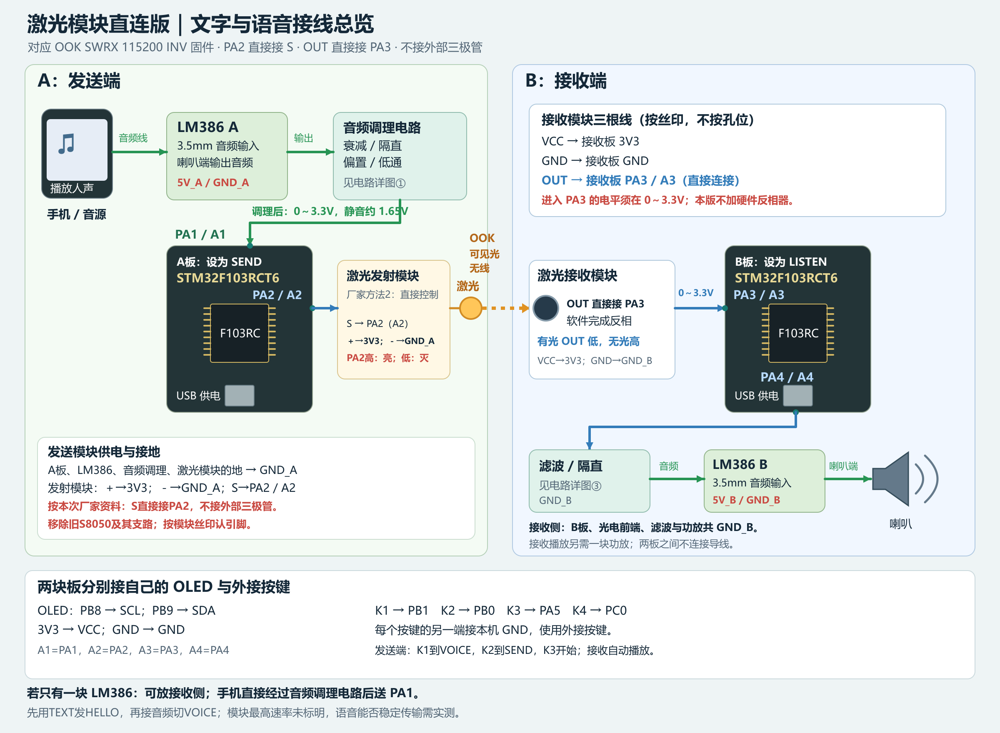
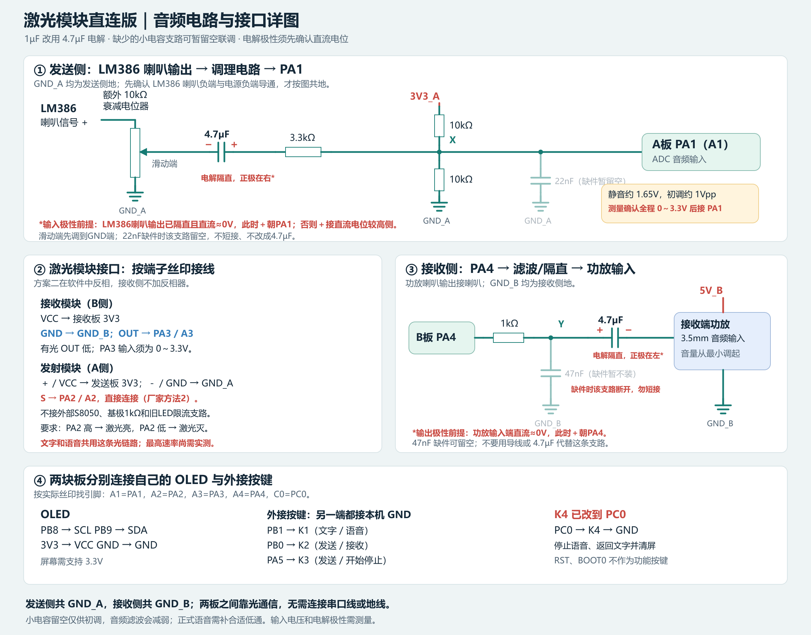

# 激光模块：方案二，软件反相接收

当前工程：[Project.uvprojx](../Project.uvprojx)，使用说明见 [README](../README.md)。

## 当前方案二接线图

以下为当前软件反相、模块直连版本：接收OUT直接接PA3。根据厂家新提供资料“方法2”，对应发射模块的S直接接PA2，正极接3V3，负极接本机GND，不接原外部S8050及其支路。按模块丝印认引脚。

音频图已按用户现有4.7µF有极性电容标出替换1µF的条件与极性。22nF/47nF缺件时只可先留空联调，不能短接或直接换成4.7µF；省略后滤波不足，实际音质及混叠需检查。

## 接收板接线

| 激光接收模块 | STM32F103RCT6 接收板 |
|---|---|
| VCC | 模块支持 3.3V 时接 3V3（所给同品牌资料标注支持 3.3～5V） |
| GND | GND |
| OUT | PA3（丝印 A3），直接连接 |

不再添加硬件反相电路。模块输出进入 PA3 前必须保持 0～3.3V；若模块必须 5V 供电，需要先确认 OUT 电平，必要时做电平匹配。

默认假设：有激光时 OUT 低，无激光时 OUT 高。若实测相反，把 Hardware/OOK.h 的 OOK_RX_INVERTED 从 1 改为 0，再重新编译和烧录接收板。

新版本默认使用反相：原图标注的“有光 PA3 高”和“OUT 经反相器再 PA3”不适用于当前设置。音频采集、DAC 输出、OLED 与按键接法仍按原说明。

## 发射板连接

PA2（丝印 A2）仍输出 USART2 TX，115200baud、8N1。通过模块 S 脚控制激光明灭，模块电源按其规格连接，GND 与发射板共地。

对应本次厂家资料的模块：正极接3V3、负极接本机GND、S直接接PA2。移除原外部S8050及其基极1kΩ、普通LED的330Ω限流支路，不将其串入模块接口。厂家资料未给出最高响应速率，当前115200链路及语音仍需实测。

[厂家资料：发射模块方法2，S接单片机控制](https://www.ydxhuo.com/index.php?c=read&id=109)

SEND 空闲 TX 高，对应激光亮；LISTEN 时 PA2 作为普通输出拉低，对应本机激光灭。初次联调先保持文字 SEND，不按 K3 时检查激光能否亮、接收 OUT 能否随遮挡切换，再传文字。

## 新版软件怎样接收

1. USART2 只开 TX，关闭其硬件接收，PA3 为普通上拉输入。
2. TIM5 更新事件触发 DMA2 通道2，将 GPIOA->IDR 采到静态循环缓冲。
3. 按 4 倍位速率采样。当前 72MHz 时钟树、USART2 BRR=312，TIM5 ARR=155，实际采样约 461538Hz，对应实际发送约 115385baud。
4. 在样本上先执行电平反相，随后检测起始位、在各数据位中心取样、检查停止位。
5. 还原出的字节交给原帧解析器和 CRC；文字消息和语音包的帧格式未改。
6. 初始至少观察到一个位周期的归一化空闲电平才接收；停止位错误丢残帧并重新同步。
7. 两个采样半区交替处理，每半区 512 点约 1.11ms。先复制到静态快照，再解码；在复制前后确认该半区未被 DMA 覆盖。
8. 若中断处理不及时或 DMA 报错，丢弃受影响残帧，重启采样同步；不会等待数据或在中断里调用延时。
9. 发送方向停止接收采样；切回 LISTEN 时自动启动采样并清除旧状态。

只在数据位中心取样不等于每一拍都触发 CPU 中断：硬件持续采样，CPU 只在 DMA 半满/全满时批量处理。位中心之间直接跳过不需解码的拍数，保留跨半区的剩余拍数。

外设分配增加 TIM5 + DMA2 通道2，与 ADC1/DMA1通道1、USART2 TX/DMA1通道7、DAC1/DMA2通道3分开。TIM5 不使用额外外部 GPIO 输出。

## 显示与按键

OLED 第一行显示 OOK SWRX 115200 INV，可以据此确认已烧录软件反相接收版本。若切为正相，显示 POS。

文字发送提示：TEXT+SEND 下按下并松开 K3，成功提交发送队列后，TX 行保留约 1 秒 QUEUED #次数，随后显示 READY #次数。队列仍在发送时显示 BUSY；提交失败显示 REJECT；接收方向显示 LISTEN。次数仅累计本机接受的文字发送请求，上电复位清零，K4 不清零。QUEUED 和次数不代表接收端已收到，仍以对端 RX: HELLO 为准。语音界面的 IN/PLAY 提示保持原样。

- K1 / PB1：文字或语音模式。
- K2 / PB0：SEND 或 LISTEN。
- K3 / PA5：文字 SEND 发 HELLO；语音 SEND 开始/停止采集。
- K4 / PC0：停止语音并回到文字模式、清除文字显示。

文字界面的 FE 是软件 8N1 起始/停止位错误，OV 是采样缓冲未及时处理次数；它们为累计值，复位后归零。语音界面沿用 RX/CRC/GAP。rx_dma_errors、tx_drops 可从 OOK_GetStats 或 link_stats 查看。

## 联调步骤

1. 两块板重新编译、烧录当前同一工程；各自与本地外围共地，两板无需互接地线。
2. 两端 TEXT，发射端 K2 到 SEND，接收端保持 LISTEN。
3. 检查接收模块 OUT：持续有光应约 0V，遮挡后应为高电平且不超过 3.3V。
4. 发射端 K3 发送 HELLO；接收端应显示 HELLO。观察 FE/OV，若 FE 增长先查极性、光路波形和模块响应；若 OV 增长说明处理期限被错过。
5. 文字稳定后，再按原音频调理接线，切两端到 VOICE，发送端 K3 开始，接收端自动缓冲播放。

当前仍为 115200，保留 8kHz/8位语音数据率。仅更改软件极性不能提高模块本身带宽；图片中的成品模块是否能恢复 8.68µs 量级位宽，尚需实物示波器及误码联调确认。

如果必须降低波特率才能收文字，需要两端同步改 OOK_BAUD_RATE 后重新编译。低于当前语音所需链路速率时只做文字联调，不能继续按本配置启动实时语音。当前没有自动降速功能。

## 编译与依据

完整重编译日志：Objects/SoftwareRx-build.log。可下载文件：Objects/Project.axf。软件未自动烧录到硬件，尚未完成实际光路、采样处理期限和语音连续性验证。

[ST RM0008：TIM5_UP 对应 DMA2 通道2](https://www.st.com/resource/en/reference_manual/cd00171190.pdf)
[模块品牌资料：有光 OUT 低](https://www.raspi.cc/index.php?c=read&id=79&page=1)

最终完整重编译：Keil ARMCC V5.06 update 5，0 错误、0 警告。Code=17456、RO-data=3308、RW-data=84、ZI-data=8252 字节，Flash 内容约 20.4KiB，静态 RAM 与栈/堆预留合计约 8.1KiB。
